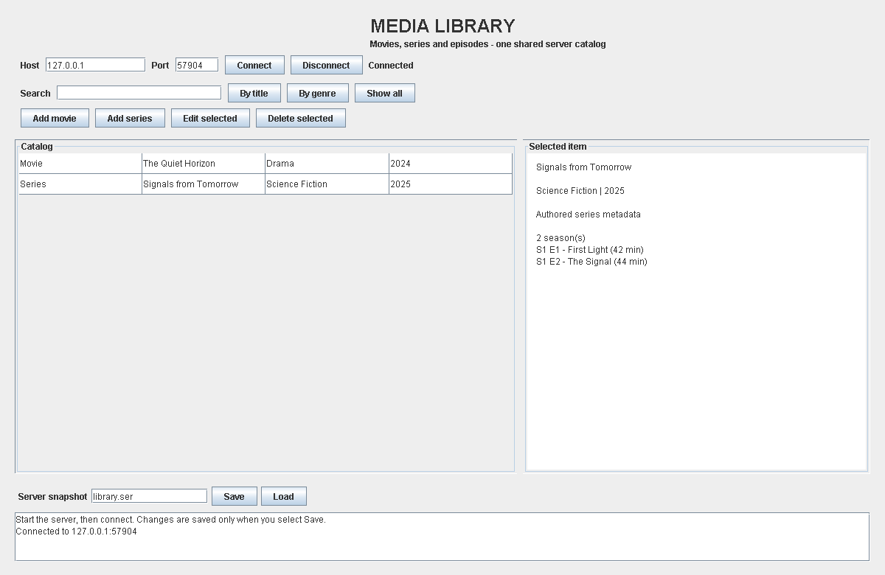
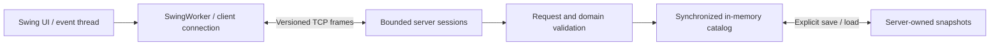

# Distributed Media Library in Java

A Java Swing client and TCP server for managing movies, TV series and episodes.
Built from university coursework by Spiros Grouztidis and revised into a tested,
English-language portfolio project.




*Actual Swing panel rendered during an automated test after connecting to a
local server. The entries are authored fixtures; the displayed port is temporary.*

## What this demonstrates

- **Client/server separation:** shared protocol and domain types, independent
  server and desktop entry points, request/response messages over TCP.
- **State management:** validated CRUD, title and genre search, explicit
  snapshots, failed-load rollback and deep copies at the catalog boundary.
- **Concurrency:** up to eight client sessions, synchronized catalog operations
  and background network work that keeps Swing's event thread available.
- **Defensive engineering:** bounded frames, a serialization allowlist,
  timeouts, confined snapshot names and loopback binding by default.
- **Executable evidence:** 16 regression scenarios covering real sockets,
  concurrency, malformed input, persistence and GUI connection/search.

This is a single-server, shared-catalog application. “Distributed” refers to
separate client and server processes; it does not imply replication, consensus
or high availability. No video files are stored or streamed.

## Run in two terminals

Install a **JDK 17 or newer** and confirm both `java -version` and
`javac -version` work. No Maven, Gradle, database, external libraries or package
downloads are needed. Run these commands from the repository root in PowerShell,
Command Prompt, Bash or another terminal.

Build the runnable JAR and run all tests:

```text
java tools/Build.java test
```

Start the server in terminal 1:

```text
java -cp build/media-library.jar server.ServerMain
```

Start the Swing client in terminal 2:

```text
java -jar build/media-library.jar
```

Click **Connect** using `127.0.0.1` and port `5000`. Add a movie or a series,
search by title or genre, select a row to edit/delete, and use **Save** to write
a snapshot. **Load** replaces the shared catalog for every client. Unsaved
changes are lost when the server stops; startup does not automatically load files.

For a build without tests, run `java tools/Build.java package`.

## Try the sample catalog

With a fresh, empty server running:

```text
java -cp build/media-library.jar demo.DemoClient
```

This sends ordinary network requests to add two fictional movies and one
series, runs a search and saves `data/demo.ser`. Connect or select **Show all**
in the GUI to inspect them. The demo refuses to modify a nonempty catalog.
It is a sequence of operations, not an atomic import; run it without other writers.

To use a different port and storage directory:

```text
java -cp build/media-library.jar server.ServerMain 5050 data-demo 127.0.0.1
java -cp build/media-library.jar demo.DemoClient 5050
```

Set the same port in the GUI. A different listening address is an explicit
third server argument; review [deployment boundaries](SECURITY.md) first.

## Architecture



Each frame carries a fresh Java serialization stream, with a 1 MiB limit and
an explicit class allowlist. Fresh streams prevent stale object references
from being reused across requests. The public wire format differs from the
coursework version; run the client and server built from this same repository.

## Behavior worth knowing

| Operation | Rule |
|---|---|
| Title search | Case-insensitive substring |
| Genre search | Case-insensitive exact match |
| Identity | Trimmed, case-insensitive title **and** media type |
| Update | Replaces metadata/episodes; title and type identify the item |
| Delete | Uses selected media type and title, avoiding same-title ambiguity |
| Persistence | Explicit snapshots; validated replacement on load |
| Concurrent edits | Individual operations are serialized; last accepted update wins |
| Capacity | Up to 1,000 items, subject to stricter serialized byte/graph limits |

There is no rename operation or stable database ID. Clients do not receive push
updates; select **Show all** to refresh another client's changes.

## Repository guide

| Location | Purpose |
|---|---|
| [src/main/java](src/main/java) | Shared models, framing, server, Swing client and demo |
| [src/test/java/tests/TestSuite.java](src/test/java/tests/TestSuite.java) | Dependency-free regression and integration scenarios |
| [tools/Build.java](tools/Build.java) | Cross-platform build, JAR packaging and tests |
| [Architecture and protocol](docs/architecture.md) | Boundaries, operation contract and tradeoffs |
| [Demo walkthrough](docs/demo.md) | GUI steps, expected behavior and troubleshooting |
| [Verification record](docs/verification.md) | Tested environment, scenarios and limits |
| [Provenance](docs/provenance.md) | Original work and public refactor changes |
| [GitHub upload guide](docs/github-upload.md) | Description, topics and exact upload contents |
| [References](references/README.md) | Official Java documentation |

## Scope and evidence

Local compilation and all 16 scenarios passed on Windows 11 with JDK 23.0.1,
targeting Java 17 bytecode. Hosted CI is configured for Windows/Linux and JDK
17/21; its remote status is only established after upload. The automated UI
test connects, searches and renders the actual panel. It does not manually
exercise every native window, modal form or platform look-and-feel.

There is no authentication, authorization or TLS. Connected clients share full
catalog privileges. Loopback defaults and input restrictions reduce specific
risks but do not make Java serialization appropriate for an internet-facing
service. Read [SECURITY.md](SECURITY.md) for concrete boundaries and next steps.

## Attribution and license

The original domain model and operation set come from the author's coursework.
The public transport, server, GUI, tests and documentation were revised with
AI assistance. Original IDE output, student identifiers and coursework documents
are excluded. See [provenance](docs/provenance.md) for an explicit change table.

Project code and documentation are provided under the [MIT license](LICENSE).
This repository does not include third-party movies, episodes or media artwork.
